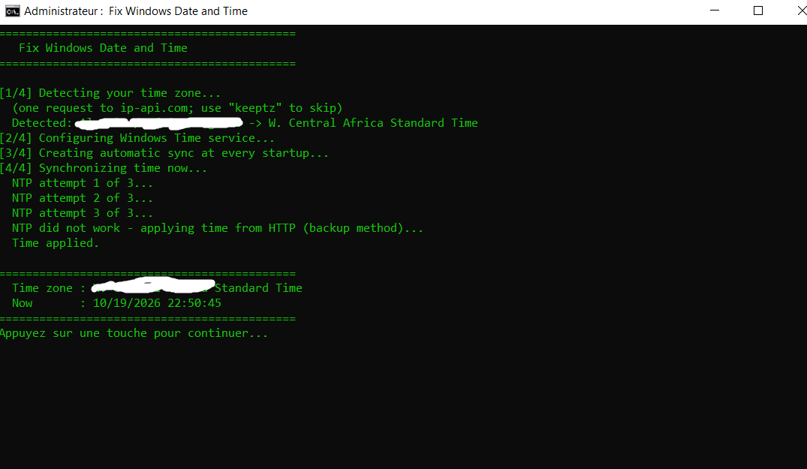

# Fix Windows Time | إصلاح الوقت والتاريخ في ويندوز

[English](#english) | [العربية](#العربية)



---

## English

One-click fix for a Windows PC whose **date or time keeps going wrong** (for example the date jumps to 2030 after the PC is turned off).

### What it does
1. Detects your time zone automatically from your IP address and applies it.
2. Configures the Windows Time service so it can correct even a very large error.
3. Synchronizes the clock using NTP, with an automatic backup method over HTTP if NTP is blocked.
4. Creates a startup task so the clock is re-synchronized every time the PC starts.

### How to use
1. Download `Fix_Windows_Time.bat` (from the **Releases** page or the file list above).
2. Double-click it and accept the administrator prompt (**Yes**).
3. Wait until you see your time zone and the current time, then press any key.

> If Windows shows **"Open File - Security Warning"** (*the publisher could not be verified*), click **Run**. If it shows **"Windows protected your PC"**, click **More info** then **Run anyway**. The file is a plain-text script: you can open it in Notepad and read everything it does.

### Options
Run it from a command prompt with `keeptz` to **keep your current time zone** (no IP lookup):

```
Fix_Windows_Time.bat keeptz
```

### Privacy
- The script makes **one request to `ip-api.com`** to find your time zone. Nothing is stored or sent anywhere else. Use `keeptz` to skip it.
- If you use a VPN, the detected time zone will be the VPN server's. Use `keeptz` in that case.
- Time is checked over plain HTTP on purpose: HTTPS fails when the system date is very wrong.

### What it changes on your PC
- Time zone (unless `keeptz` is used).
- Windows Time service settings (servers: `time.windows.com`, `time.google.com`, `pool.ntp.org`) and two registry values in `HKLM\SYSTEM\CurrentControlSet\Services\W32Time\Config` (`MaxPosPhaseCorrection`, `MaxNegPhaseCorrection`).
- A scheduled task named `FixWindowsTimeSync` and a copy of the script at `C:\ProgramData\Fix_Windows_Time.bat`.

### Uninstall
Run in an administrator command prompt:

```
schtasks /delete /tn "FixWindowsTimeSync" /f
del "C:\ProgramData\Fix_Windows_Time.bat"
```

### Still happens after a restart?
If the date goes wrong again after shutting the PC down for a while, the **CMOS battery** (a CR2032 coin cell on the motherboard) is most likely dead. Replacing it fixes the problem at the root.

### Disclaimer
Provided "as is" under the MIT license. Use at your own risk.

---

## العربية

حل سريع بنقرة واحدة لجهاز ويندوز **يتغير فيه التاريخ أو الوقت باستمرار** (مثلاً يظهر التاريخ 2030 بعد إطفاء الجهاز).

### ماذا يفعل السكريبت؟
1. يكتشف منطقتك الزمنية تلقائياً من عنوان IP ويطبقها.
2. يضبط خدمة الوقت في ويندوز لتصحح حتى الفروقات الكبيرة جداً.
3. يزامن الساعة عبر NTP، ويستعمل طريقة بديلة عبر HTTP إذا كان NTP محجوباً.
4. ينشئ مهمة تعمل عند كل تشغيل للجهاز لإعادة مزامنة الساعة.

### طريقة الاستعمال
1. حمّل الملف `Fix_Windows_Time.bat` (من صفحة **Releases** أو من قائمة الملفات أعلاه).
2. شغّله بنقرتين ووافق على طلب صلاحيات المسؤول (**Yes**).
3. انتظر حتى تظهر المنطقة الزمنية والوقت الحالي، ثم اضغط أي زر.

> إذا ظهرت نافذة **Open File - Security Warning** (الناشر غير معروف) فاضغط **Run** (في ويندوز الفرنسي: **Exécuter**). وإذا ظهرت **Windows protected your PC** فاضغط **More info** ثم **Run anyway**. الملف نص عادي يمكنك فتحه بالمفكرة وقراءة كل ما يفعله.

### خيار إضافي
لإبقاء منطقتك الزمنية الحالية (دون طلب IP)، شغّله من موجه الأوامر هكذا:

```
Fix_Windows_Time.bat keeptz
```

### الخصوصية
- يرسل السكريبت **طلباً واحداً إلى `ip-api.com`** لمعرفة المنطقة الزمنية، ولا يخزّن شيئاً ولا يرسل بياناتك إلى جهة أخرى. استعمل `keeptz` لتجاوز ذلك.
- إذا كنت تستعمل VPN فستكون المنطقة المكتشفة هي منطقة خادم الـ VPN، فاستعمل `keeptz`.
- يتحقق السكريبت من الوقت عبر HTTP العادي عمداً، لأن HTTPS يفشل حين يكون تاريخ النظام خاطئاً جداً.

### ما الذي يغيّره في جهازك؟
- المنطقة الزمنية (إلا مع `keeptz`).
- إعدادات خدمة الوقت (الخوادم: `time.windows.com` و`time.google.com` و`pool.ntp.org`) وقيمتان في السجل (`MaxPosPhaseCorrection` و`MaxNegPhaseCorrection`).
- مهمة مجدولة باسم `FixWindowsTimeSync` ونسخة من السكريبت في `C:\ProgramData\Fix_Windows_Time.bat`.

### الإزالة
شغّل في موجه أوامر بصلاحيات المسؤول:

```
schtasks /delete /tn "FixWindowsTimeSync" /f
del "C:\ProgramData\Fix_Windows_Time.bat"
```

### المشكلة تتكرر بعد إعادة التشغيل؟
إذا عاد التاريخ إلى الخطأ بعد إطفاء الجهاز لفترة، فالسبب غالباً **بطارية CMOS** (قطعة نقدية CR2032 على اللوحة الأم) فارغة. استبدالها يحل المشكلة من جذورها.

### إخلاء مسؤولية
يُقدَّم كما هو (as is) بترخيص MIT. الاستعمال على مسؤوليتك.
